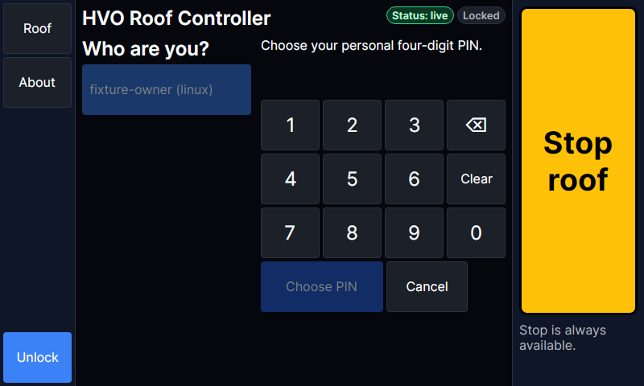
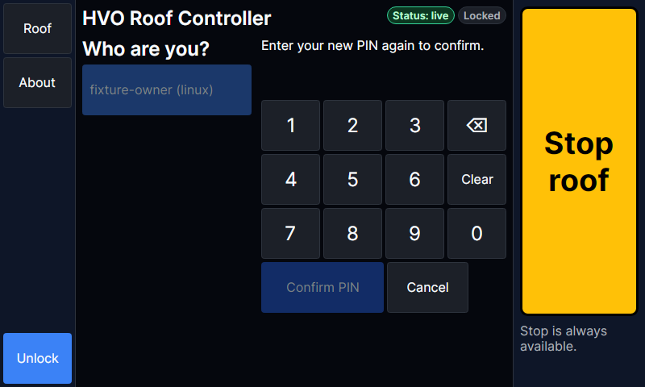

# First-install kiosk PIN commissioning

This flow is available only for a genuine first Linux installation that includes the controller (or emulated rig)
and kiosk, explicitly enables native Linux authentication, selects exactly one existing human Linux administrator,
and does not also request a virtual first administrator. The installer binds a separate kiosk credential to that
person's stable principal ID and native enrollment. It does not change the Linux password/PAM policy or use the
kiosk runtime account as owner. The hvo-kiosk service account is explicitly ineligible.

Existing installations, upgrades, reinstalls over retained configuration/data, and virtual-only installations receive
no temporary access. Existing-Pi migration requires a separately approved procedure; this feature performs none.

## At the touchscreen

1. Select the owner and enter the documented temporary PIN **0000** within 24 hours of installation.
2. Choose a personal four-digit PIN different from the temporary PIN, then enter it again to confirm.
3. After “PIN saved,” sign in again using the new PIN. Saving never signs the user in automatically.

Before step 3 the console remains locked. The setup token authorizes only PIN completion, with the same currently
valid kiosk key; it cannot authorize operation, administration, configuration or key creation as a bearer session.
The separate viewer device credential retains its existing Stop/status functions. Personal PIN sessions are capped
at RoofOperator even when the owner is an administrator.

The PIN pad masks digits and distinguishes native and virtual namesakes by provider and selection ID.
Cancel clears the local token and PIN; the server grant expires after five minutes. Cancel does not extend the
24-hour installation window or itself permanently retire pending access. Restart discards setup tokens; an eligible
owner may start again within the original window.

## Retirement and recovery

Temporary access is permanently retired on completion, expiry, another human being added while pending, owner
removal/disablement/stamp change, or confirmed native revocation. Re-enabling an owner or deleting the additional
person never restores it. Adding another person after completion keeps the personal PIN. Credentials never transfer
to a namesake. Owner role/stamp changes retire the credential and PIN sessions, requiring explicit recovery.

Native validation distinguishes confirmed rejection from worker/PAM unavailability. Both refuse access; only
confirmed rejection retires the credential. Changes are detected on revalidation: an external disable/re-enable
entirely between observations cannot be detected. Transport errors, helper timeouts and unknown PAM failures fail
closed without claiming confirmed revocation.

Five failed or interrupted checks lock the credential for five minutes. Each guess is saved before verification;
restart does not clear the counter. Successful verification resets it. Verification is serialized. Random setup
tokens are device-bound, stored only as hashes in server memory, and expire after five minutes. Concurrent completion
can install only one PIN. Device revocation and principal changes are rechecked at commit.

## Persistence, backup and rollback

The installer exclusively creates a durable claim at /var/lib/hvo-roof-commissioning/first-install-claimed before
configuration/data. Only that execution may seed pending state before controller startup. A crash after claiming
can consume eligibility without creating access: preserve evidence and recover explicitly, never delete the claim.
Uninstall/purge retains the claim.

Pending state and the separate PIN hash use identity schema 3. Schema 1/2 remains supported and is never automatically
granted pending state. Installer and deployment rollback guards require schema-3 image/release capability and never
restore an older credential backup automatically.

Completion/retirement first durably writes identity.json.kiosk-retired, then atomically replaces the identity document.
File data and directory entries must be flushed. A crash between writes leaves temporary access retired even if
the old pending document survives. Preserve the sidecar with the identity directory. Failed persistence never
reports successful completion or returns an operational session.

Backups include the claim and identity directory. Restore refuses archives with pending commissioning before writing
installation files, including onto an empty replacement machine. Missing identity data never recreates a credential.
Deliberate whole-disk rollback or removal of all durable history is outside this guarantee. No automatic reset/regrant
command is supplied: preserve backups and use explicitly approved administrator recovery; never restore pending state.

## Validation

Synthetic tests cover atomic completion, fresh login, setup-token rejection, stable IDs/namesakes, additional-human
retirement, owner disablement, expiry, persistent lockout, revoked keys, retained retirement markers, failed writes,
fresh claims, failed claim flush, repeat/deletion refusal and pending-backup restore refusal. API/UI tests exercise
the real controller and native-worker response formatter over an isolated Unix socket, and render Choose/Confirm
at 1280×720 and 800×480.

These tests do not claim physical touch testing, real-account PAM policy testing or physical power-cut injection.
Native unavailable/revoked responses and synthetic crash boundaries are tested without changing host credentials.
