# Touchscreen kiosk

The kiosk (`hvo-roof-kiosk`, `HVO.RoofControllerV4.Kiosk`) is the roof controller's touchscreen at the roof: a
Raspberry Pi touch display on the controller's Pi, showing the roof full screen from boot. Anyone at the roof can
watch it and press Stop. To open or close the roof, a person unlocks it with their name and PIN. PIN sessions permit
roof operation only, including for an Admin; settings and administration use the web UI, CLI/TUI or password-authenticated
Mac app ([interface rights](authentication-interfaces.md)).

Like [`hvo-roof`](cli.md) and the [web UI](web.md), it is a client of the controller: it calls the REST API and
follows the live status hub with its own device key, and never drives the HAT itself. The controller decides what the
person who unlocked it may do. The kiosk draws straight on the display through DRM and reads the touchscreen through
libinput: there is no X11 or Wayland, and no desktop to escape to. Its screens (`HVO.RoofControllerV4.Screens`) are
Avalonia controls, in HVO Dark, the observatory's web theme, as the web UI and the terminal interface use.

The installer sets it up on the controller's Pi ([Install](#install)).

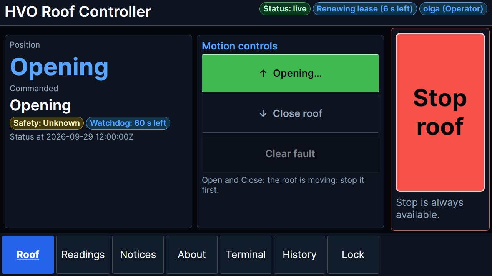

## Emulated rig orientation

For a fresh `rig` plus `kiosk` installation, the default rotation is 0 degrees. An explicit
`kiosk.rotation` wins; existing kiosk settings are preserved when rotation is omitted.
The physical controller's fresh-install default remains 90 degrees. This does not change
the production Pi or any existing deployment.

A Pi running the emulated HAT still has a physical display. Do not reuse a VM's zero-degree
answers unchanged. Choose the mounted screen's angle explicitly (90 or 270 for a portrait
panel mounted in landscape), and request the optional splash separately. For example:

```json
{
  "roles": ["rig", "kiosk"],
  "kiosk": {
    "card": "",
    "rotation": 90,
    "splash": { "enabled": true, "image": "/operator/approved-scene.png" }
  }
}
```

Add the current machine's required rig confirmation and the explicitly selected administrator
as described in [Install](install.md). The image must remain available for later upgrades;
never substitute a test screenshot or infer permission to distribute the artwork.
The installer's completion text reports effective rotation and whether managed splash state
exists. A healthy kiosk process does not verify the picture, touch alignment, or boot/shutdown
appearance. Record those checks separately, and keep a reported failure open until the operator
confirms the correction after a coordinated restart.

## The screen

- **Navigation** along the bottom: Roof, Readings, Notices, About, Terminal and Unlock (Lock while unlocked). Administration belongs in the CLI/TUI or web UI. Terminal appears only in the systemd-managed direct-display kiosk.
- **The header**: the controller's name, and badges for the status (`Status: live`, `connecting`, `reconnecting`,
  `STALE`, `unreachable` or `refused`), the operator lease while the kiosk renews it (`Renewing lease (6 s left)`), and
  who unlocked the kiosk (`olga (Operator)`), or `Locked`.
- **Safety summary** under the header: connecting, simulation/safety-mode warning, stale/refused/unreachable status,
  latched fault or unhealthy I/O. **Readings** retains every full warning before the controller-backed status values;
  Previous/Next pages keep long answers reachable without shrinking text or touch targets.
- **Stop roof** in permanent red at the right of every page ([Stop](#stop)), enabled through focus, PIN entry and errors. Long answers have a **Full result** page; it preserves the complete shared controller response.
- Every button is at least 12 mm in both directions, and the text scales with it, so it can be used with gloves and
  read from a step back. The sizes come from `PixelsPerMillimetre`: 8.2 for the Raspberry Pi Touch Display 2
  (1280x720 in landscape), about 5.2 for the first 7-inch touch display (800x480).

<p>
  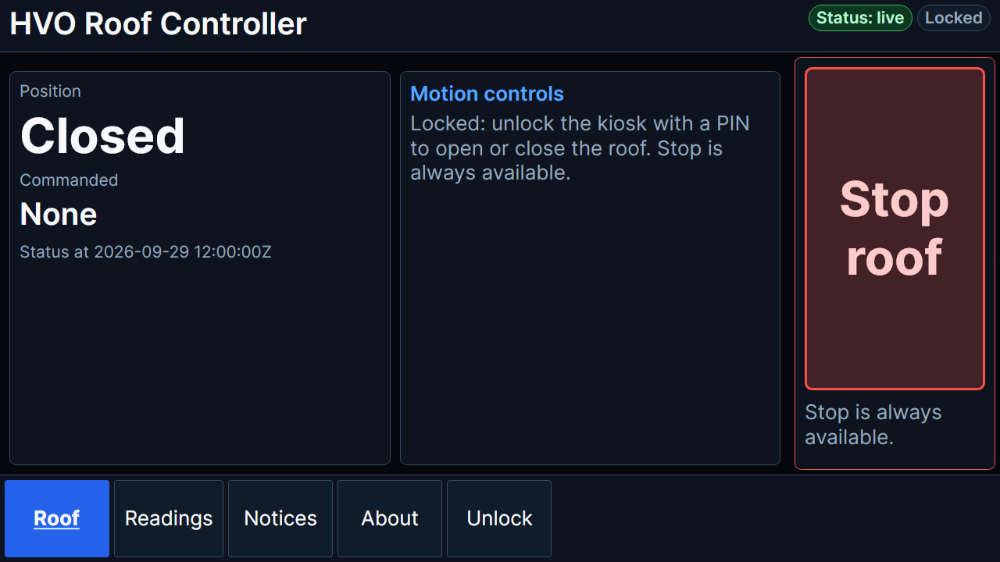
  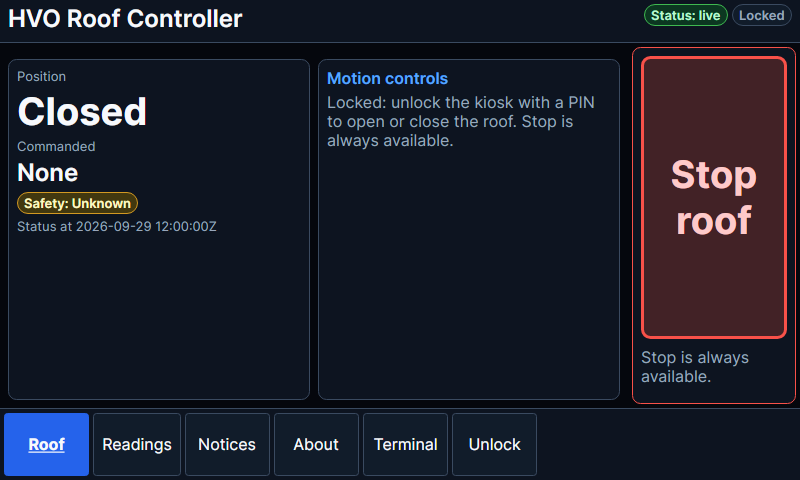
</p>

## Locked

Between people, the kiosk is locked. It shows the roof with its device key, which has the Viewer role, and offers Stop.
Open, Close and Clear fault are hidden:
`Locked: unlock the kiosk with a PIN to open or close the roof. Stop is always available.`

**Unlock** asks `Who are you?`. The names are the people with a PIN (`GET Auth/Pin/Users`, read with the device key).
A person with a display name is shown by it, with the name they sign in by: `Olga Example (olga)`; an enrolled Linux
account adds `(Linux)`. Display names are set by an admin in the web UI or with `hvo-roof` (#209). People are paginated. Choosing a name opens a separate keypad step; **Person** returns to the list. A person types their PIN on the keypad; the PIN shows as dots and is only held until it is sent.
A wrong PIN says so, and repeated wrong PINs lock that name out at every kiosk, and this kiosk for every name
([Lockout](security.md#signing-in)). When no one has a PIN yet, the page says how to give one:
`hvo-roof users set <name> --pin` or `hvo-roof pins set <name>` ([cli.md](cli.md#commands)), or the web UI's People
page.

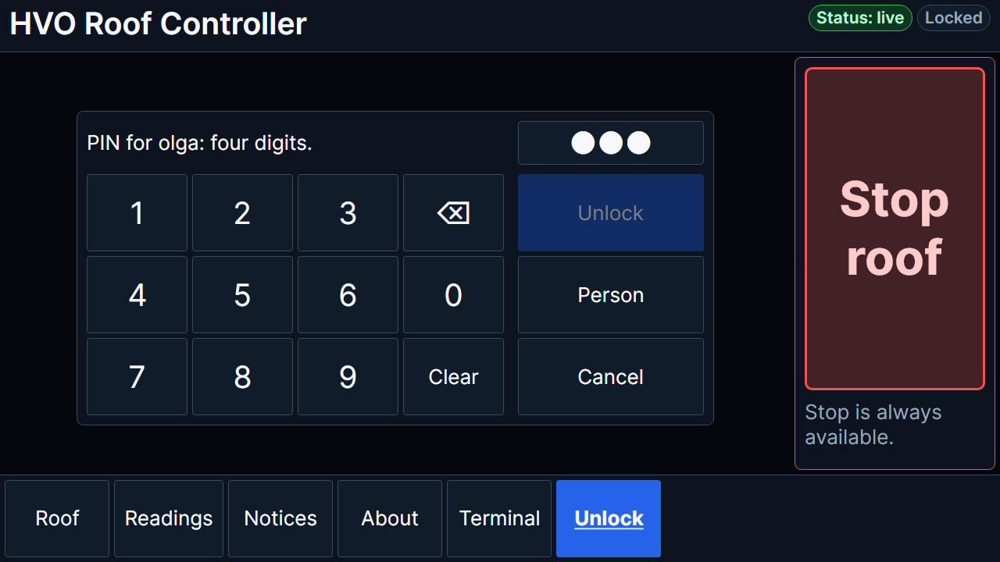

**Lock** ends the person's PIN session at the controller, then locks. The kiosk also locks by itself:

- after `IdleLockSeconds` without a touch (`Locked after 2 min without a touch.`), but never while it renews the lease
  of a motion started here, nor while a command's answer is awaited;
- when the controller ends the PIN session (its idle timeout, its lifetime, or an admin ending it):
  `The controller ended the PIN session, so the kiosk is locked.` The kiosk keeps the session open while someone uses
  it, and locks when the controller would end it anyway;
- when systemd stops it (SIGTERM): it ends the PIN session before it exits, so nobody's session outlives the kiosk.

When the kiosk locks while the roof moves on its command, it stops renewing the lease and says so:
`The kiosk was locked, so it stopped renewing the operator lease. If the roof is still moving, it stops when the lease runs out.`

## Unlocked

Every PIN session is Operator-only, including an Admin PIN. A Viewer cannot have a PIN. About explains this policy; no PIN grants host, service or terminal privileges (#153 remains separate).

### Roof

- **Open, Close and Clear fault** need the Operator role. A button that cannot be used says why under it, for example
  `Open and Close: the roof is moving: stop it first.` Open and Close are not offered on a stale status: the roof could
  not be watched.
- **The operator lease.** When the controller has a lease (`OperatorLeaseTimeout`), a move started here holds it, and
  the kiosk renews it while the roof moves (the `Renewing lease` badge). It stops renewing when the roof stops, when
  Stop is sent, and when the kiosk locks; the controller then stops the roof when the lease runs out
  ([commissioning C9](commissioning.md#c9-operator-lease-expiry)).
- **Notices** keep the last five things that happened, with their time: a command's answer, who unlocked the kiosk, the
  controller restarting, and safety alerts (`SAFETY: …`).

<p>
  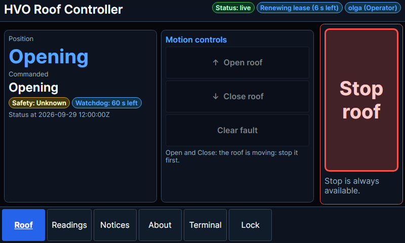
  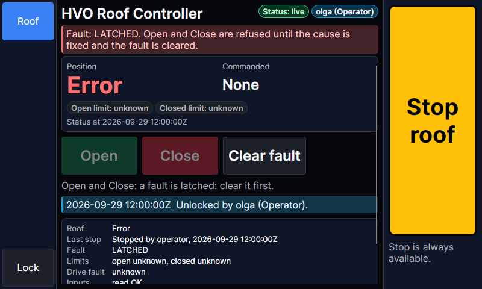
</p>

### Settings

The kiosk offers roof operation only. Configure the controller using the web UI or CLI/TUI. The shared desktop
screens remain available in the password-authenticated Mac app. PIN sessions cannot write settings.

### System

The PIN kiosk has no System page: its controller summary is on **About**. Use an authorized administrative password
session or local CLI/TUI for the host's details and restart. A PIN session does not gain these rights, even when its
account is an administrator. A kiosk set to password sign-in shows System to every role: this kiosk's version, the
controller's summary (version, uptimes, CPU, temperature, memory, disk and addresses, `GET System/Summary`) and its
health checks; for an admin, the host's details and **Restart**, while others read
`The host's details (its name, system, runtime and the controller's process) need the Admin role.`

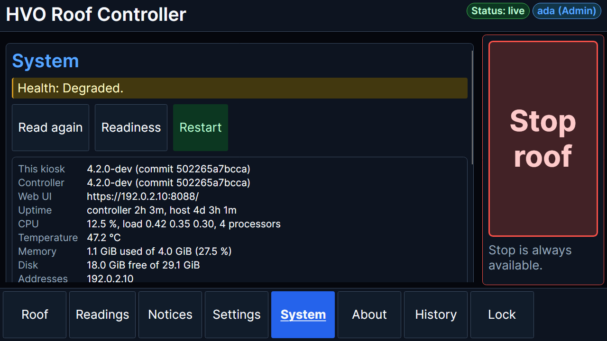

## The status

The status is current only while the hub delivers it, as in every client.

- **Before the first status** the kiosk says `Connecting to the controller…`, and claims no position.
- **Stale.** After 3 s without a status or heartbeat:
  `STALE: no status since …. Showing the last known state; Stop still works.` The position and the command are labelled
  "last known", and Open and Close are not offered.
- **Unreachable.** When the controller cannot be reached:
  `The controller cannot be reached. No status since …: showing the last known state. Stop is still tried; its answer shows whether it arrived.`
- **Refused.** When the controller refuses the device key (it was removed, or is no longer a kiosk key):
  `The controller refused this kiosk's device key, so there is no live status.` Stop is still tried.
- **The controller restarted.** A new controller instance is noted, and the screen comes on.

<p>
  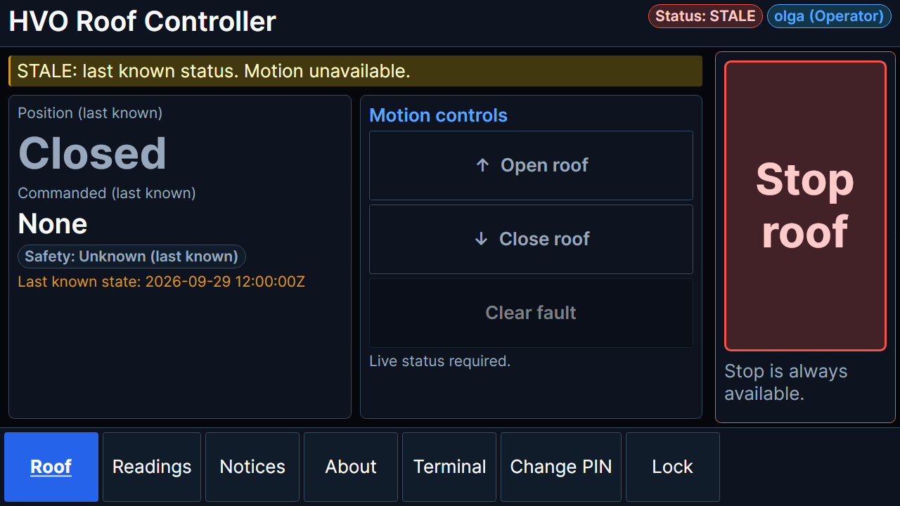
  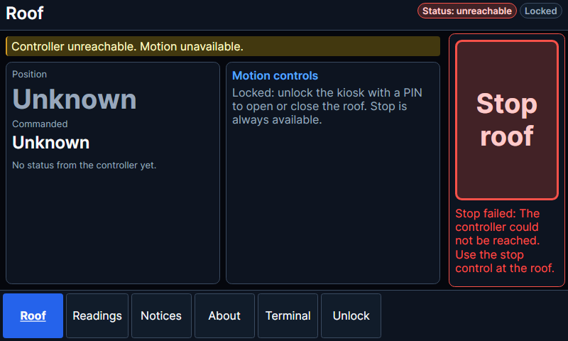
</p>

## The screen timeout

The screen goes black after the controller's `RoofControllerUi:KioskScreenTimeout` without a touch (5 minutes by
default, at most 4 hours; 0 keeps it on). An operator may change it in a password-authenticated Mac, web or CLI session. The kiosk reads it
at start and every 5 minutes. The screen stays on while the roof moves, while a command or Stop is on its way, and while
the kiosk holds a lease, and comes on when the roof starts or stops moving, when the controller restarts, and on a
safety alert.

The touch that wakes a black screen goes no further, so a touch on the dark screen cannot press what is under it: it
takes a second touch to press Stop. With `BacklightFile`, the kiosk also turns the backlight off while the screen is
black, and on again at the touch.

## Stop

**Stop roof** is at the right of every page, locked or not. It is never disabled, needs no PIN and no role, and uses
the same words as every other client.

- It is sent at once, on a connection of its own, with the device key (and the PIN session when there is one): it never
  waits for a command, a lock or the status.
- The answer shows under it, for example `Stop acknowledged. Relay register verified de-energized.`, or why Stop
  failed, with `Use the stop control at the roof.` Nothing else claims that Stop arrived.
- Stop wins: an Open or Close accepted after a Stop was sent is stopped again.

## Exit UI to terminal and return

Choose **Terminal → Exit UI to terminal**, read the bounded pages, then **Confirm exit**. An unlocked operator
PIN is required (an administrator's PIN is still capped at Operator). The kiosk checks that the same session is
still valid at the controller immediately before exiting. A locked/device-only session, viewer, expired/revoked
session or unavailable controller cannot authorize exit. **Cancel**, Escape, or leaving Terminal keeps the UI
running; errors keep the UI available. **Stop roof** stays visible and enabled through the flow.

This closes only the kiosk process. It neither reboots Linux nor restarts the controller, and sends no roof-motion
or implicit Stop command. Its PIN session ends and lease renewal stops. With the operator lease enabled, ordinary
lease expiry stops a moving roof; with it disabled, closing a client adds no stop policy. Use **Stop roof** before
exit when a stop is wanted.

After the kiosk process has ended, systemd runs a fixed handoff: it queues `hvo-roof-terminal.service` and selects
tty1. The process boundary releases all DRM/libinput file descriptors and workers; Avalonia 12.1.3 does not expose
a disposal API for these backends. Terminal reset, hangup and VT deallocation restore the text console. The dedicated
terminal unit runs `agetty` with ordinary `/bin/login`, without autologin, independently of any `getty@tty1` override.
The UI's role or PIN grants no Linux login or sudo rights. A keyboard and a separately authorized Linux account
are needed to use the terminal; no shell is preauthenticated or privileged by this action.

To return, sign in to Linux and run:

```bash
sudo systemctl start hvo-roof-kiosk.service
```

Linux's existing sudo policy authorizes this command. The kiosk replaces the tty1 login with a hangup, reacquires
display/input ownership, and starts **locked** with its viewer device key. Unlock again with a personal PIN to
operate. Log out of other Linux terminals when finished. The kiosk is still enabled for the next boot; this action
does not change boot configuration. **Terminal** is absent in the Mac app and development `--window` mode.

The unit retains crash recovery (`Restart=always`, 5 s), but treats authorized exit code 80 as successful and prevents
its restart. Invalid settings (78) also prevent restart. An unexpected clean exit or crash still restarts. Only the
main process's successful exit 80 activates the login handoff. The handoff uses fixed host commands and touches
no controller service, container or credentials. Its root-owned script is installed program code, outside data
backups and independent of the executable so an older program can be rolled back without understanding a new
handoff argument. The installer checks the helper, both units and every parent directory: existing paths must be
root-owned, without group/other write permission or symbolic links. It refuses an unsafe installation, including
an unchanged helper owned by another user, and leaves its existing data and keys alone. A Linux administrator must
secure or move aside the unsafe paths before reinstalling. The same checks guard service activation during
certificate renewal and rollback; a restore reinstalls the helper from program resources, never backup data.
TTY input stays on tty1, while stdout and stderr explicitly go to the journal, including startup refusals and
handoff failures: `journalctl -u hvo-roof-kiosk`.
From a separately authenticated recovery login (for example SSH), use `sudo systemctl start hvo-roof-terminal.service`
to restore the login or `sudo systemctl start hvo-roof-kiosk.service` to restore the locked UI. A Linux administrator
can also restart the kiosk after correcting invalid settings. Controller Restart in password-authenticated clients
and host reboot are separate administration actions; neither is part of **Exit UI to terminal**.

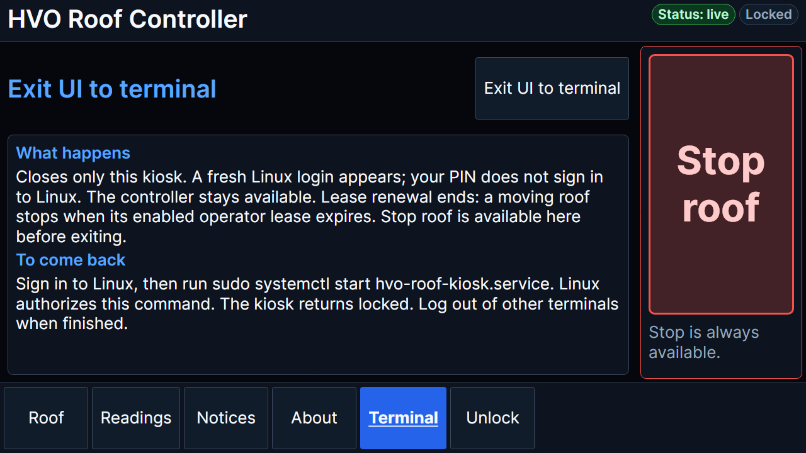

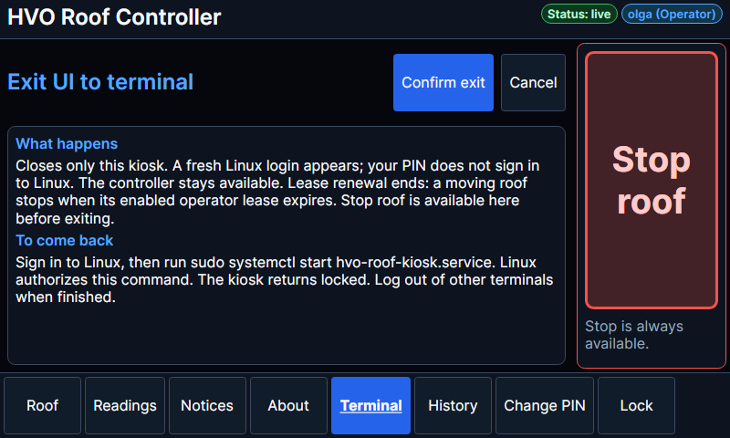

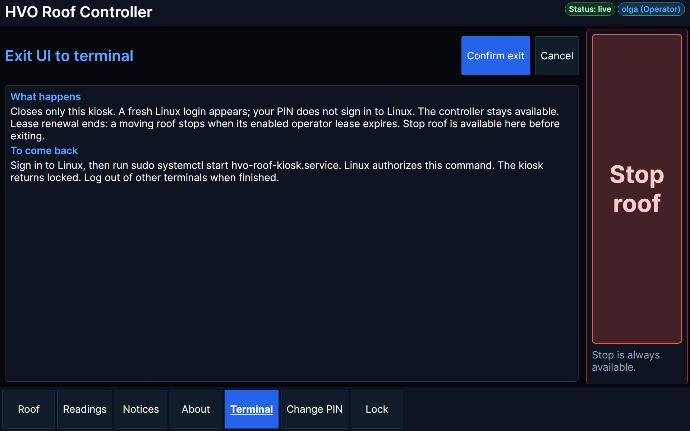

## Install

The kiosk runs on the controller's Pi, beside the controller's container, as a systemd service. It needs Raspberry Pi
OS Lite (no desktop): nothing else may hold the display.

The installer sets it up ([install.md](install.md#the-kiosk)). On the controller's Pi, with the touch display
connected, choose the kiosk with the controller, or on its own once the controller is installed:

```bash
sudo hvo-roof-install
```

It does each step below, and checks each on a later run. Its answers file has the kiosk's two choices
(`kiosk.hideCursor`, `kiosk.pins`), and `--plan` shows the steps before anything changes.

### By hand

The steps the installer takes, for a Pi set up without it:

1. **Packages.** The display and input libraries, and fontconfig:

   ```bash
   sudo apt install libdrm2 libgbm1 libegl1 libgles2 libinput10 libfontconfig1 kbd
   ```

   To hide the console's cursor behind the kiosk, add `vt.global_cursor_default=0` to `/boot/firmware/cmdline.txt`.

2. **The user.** The kiosk runs as `hvo-kiosk`, in `video` (the display, and the backlight with the udev rule),
   `input` (the touchscreen) and `render` (the GPU):

   ```bash
   sudo useradd --system --user-group --no-create-home --shell /usr/sbin/nologin hvo-kiosk
   sudo usermod -aG video,input,render hvo-kiosk
   ```

3. **The program.** Steps 3, 5 and 6 install the program and its files from one directory that holds them side by
   side, and run in it. Each release has it among its assets ([Versions and releases](releasing.md#the-assets)):

   ```bash
   tar -xzf hvo-roof-kiosk-4.0.0-linux-arm64.tar.gz
   cd hvo-roof-kiosk-4.0.0-linux-arm64
   ```

   CI builds the same directory for the Pi: unpack its `hvo-roof-kiosk-<run id>` artifact and `cd` into it. Or publish
   it from a checkout, at the repository's root:

   ```bash
   dotnet publish src/HVO.RoofControllerV4.Kiosk -c Release -r linux-arm64 -o hvo-roof-kiosk
   cp src/HVO.RoofControllerV4.Kiosk/deploy/* hvo-roof-kiosk/
   cd hvo-roof-kiosk
   ```

   Then install the program:

   ```bash
   sudo install -d /opt/hvo-roof-kiosk
   sudo install -m 755 hvo-roof-kiosk /opt/hvo-roof-kiosk/
   ```

   The installer keeps the program it replaces as `/opt/hvo-roof-kiosk/hvo-roof-kiosk.previous`. To go back to it:

   ```bash
   sudo systemctl stop hvo-roof-kiosk
   sudo cp -p /opt/hvo-roof-kiosk/hvo-roof-kiosk.previous /opt/hvo-roof-kiosk/hvo-roof-kiosk
   sudo systemctl start hvo-roof-kiosk
   ```

4. **The device key.** Give the kiosk a key of its own, with the `RoofViewer` role, marked `Kiosk` (and `Local`, so an
   admin may change the local-only settings here). Add it to the controller's secrets as any configured key
   ([Provisioning API keys](security.md#provisioning-api-keys)), under the next free index:

   ```bash
   N=3   # the next free index (sudo ls /etc/hvo-roof/secrets)
   KEY=$(openssl rand -base64 32 | tr -d '\n')
   D=/etc/hvo-roof/secrets/RoofControllerSecurity__ApiKeys__$N
   printf '%s' 'roof-kiosk' | sudo tee "${D}__Name"  >/dev/null
   printf '%s' 'RoofViewer' | sudo tee "${D}__Role"  >/dev/null
   printf '%s' "$KEY"       | sudo tee "${D}__Key"   >/dev/null
   printf '%s' 'true'       | sudo tee "${D}__Kiosk" >/dev/null
   printf '%s' 'true'       | sudo tee "${D}__Local" >/dev/null
   sudo find /etc/hvo-roof/secrets -type f -exec chmod 600 {} +
   ```

   Then give the kiosk its copy, readable by `hvo-kiosk` alone, and restart the controller so it reads the new key:

   ```bash
   sudo install -d -m 750 -g hvo-kiosk /etc/hvo-roof-kiosk
   printf '%s' "$KEY" | sudo install -m 400 -o hvo-kiosk -g hvo-kiosk /dev/stdin /etc/hvo-roof-kiosk/device-key
   unset KEY
   docker restart roof-controller
   ```

   The kiosk warns at start when others than its owner can read the file.

5. **Settings.** Install the example settings as `appsettings.Local.json`, and set what differs ([Settings](#settings)):

   ```bash
   sudo install -m 644 appsettings.Local.example.json /opt/hvo-roof-kiosk/appsettings.Local.json
   sudoedit /opt/hvo-roof-kiosk/appsettings.Local.json
   ```

   In HTTPS mode the controller's API is published on port 8443 only, so the kiosk uses `https://localhost:8443/`.

   The installer's CA issues the controller's certificate for `localhost` among its names, so trust the CA: put the
   path of the CA's certificate, `/etc/hvo-roof/ca.crt` (PEM or DER, readable by the kiosk's user), in
   `ServerCaCertificateFile`, and leave `ServerCertificateSha256` out. Only that CA is trusted, and a certificate
   reissued under it needs no change here.

   A self-signed certificate, or one of your own that does not name `localhost`, is pinned by its SHA-256 instead.
   Take it from the certificate the controller serves on that port:

   ```bash
   openssl s_client -connect localhost:8443 </dev/null 2>/dev/null | openssl x509 -noout -fingerprint -sha256 | cut -d= -f2
   ```

   and put that in `ServerCertificateSha256`. A certificate reissued later has a new SHA-256, and the pin must follow
   it: `hvo-roof-install cert` does that when it renews a self-signed certificate, and restarts the kiosk. Under
   `pi-lan-http` the kiosk uses `http://localhost:8080` and neither.

6. **The service.** Install the unit, and the udev rule for the backlight when `BacklightFile` is set (the installer
   always installs the rule, which does nothing without it). The rule acts on the `add` event the boot sends, so
   apply it now with one (`udevadm trigger` sends `change` unless told):

   Before installing by hand, ensure `/opt/hvo-roof-kiosk`, `/etc/systemd/system` and their parents are ordinary
   root-owned directories writable only by root, and any existing helper or unit is an ordinary root-owned file
   writable only by root. Move unsafe paths aside without discarding existing settings or keys; use the installer
   to verify these requirements before activation.

   ```bash
   sudo install -o root -g root -m 644 hvo-roof-kiosk.service /etc/systemd/system/
   sudo install -o root -g root -m 644 hvo-roof-terminal.service /etc/systemd/system/
   sudo install -o root -g root -m 644 terminal-handoff.sh /opt/hvo-roof-kiosk/
   sudo install -m 644 99-hvo-roof-kiosk-backlight.rules /etc/udev/rules.d/
   sudo udevadm trigger --action=add --subsystem-match=backlight
   sudo systemctl daemon-reload
   sudo systemctl enable --now hvo-roof-kiosk
   ```

   It starts at boot, and again 5 s after an unexpected exit or a crash. An authorized terminal exit (80) leaves the
   fresh Linux login visible until a Linux-authorized service start or the next boot. Settings it cannot start with stop it with exit code 78
   and `The roof kiosk did not start: …` in the journal (`journalctl -u hvo-roof-kiosk`), and systemd does not restart
   it: fix them, then `sudo systemctl restart hvo-roof-kiosk`.

7. **PINs.** An admin gives each operator a personal PIN (exactly four digits) with `hvo-roof pins set <name>`, or on the web UI's
   People page. The installer gives one to each person named in `kiosk.pins` who has none.

## Settings

The kiosk's settings are the `Kiosk` section of `appsettings.Local.json` next to the program, then the environment
(`Kiosk__*`), then the command line (`--Kiosk:Name=value`), later ones winning.

| Setting | Default | Meaning |
|---------|---------|---------|
| `ControllerUrl` | `http://localhost:8080` | The controller's API. |
| `DeviceKeyFile` | none (required) | The file with the kiosk's device key, on one line. Only the kiosk's user may read it. |
| `ServerCertificateSha256` | none | For an `https://` `ControllerUrl` with a certificate the Pi does not trust: its SHA-256, as 64 hex digits (colons allowed). Not with `ServerCaCertificateFile`. |
| `ServerCaCertificateFile` | none | For an `https://` `ControllerUrl` with a certificate a private CA issued: the file with the CA's certificate, PEM or DER, which the kiosk's user must be able to read. Only that CA is trusted; the certificate must name the host in `ControllerUrl`. Not with `ServerCertificateSha256`. |
| `IdleLockSeconds` | `120` | How long the kiosk stays unlocked without a touch, from 10 to 3600. |
| `PixelsPerMillimetre` | `8.2` | The display's pixels per millimetre, from 2 to 40, which sets the size of everything. 8.2: the Raspberry Pi Touch Display 2; about 5.2: the first 7-inch touch display. |
| `Card` | the first connected | The display's DRM device, such as `/dev/dri/card1`. |
| `Rotation` | `0` | How far the picture is turned, clockwise: 0, 90, 180 or 270. The Touch Display 2's panel is portrait, so it needs 90 or 270 for landscape ([Assumptions](#assumptions)). |
| `InputDevices` | every device | The touchscreen's input devices, such as `/dev/input/by-path/…-event` (`Kiosk__InputDevices__0=…`). None: every device libinput finds. |
| `BacklightFile` | none | A backlight control written when the screen goes black and wakes, such as `/sys/class/backlight/10-0045/bl_power`. None: the screen is drawn black with the backlight on. |
| `BacklightOn`, `BacklightOff` | `0`, `4` | What `BacklightFile` is given to turn the backlight on and off (`bl_power`: 0 on, 4 powered down). |
| `Window`, `WindowSize` | `false`, `1280x720` | Runs the kiosk in a desktop window instead (for development; `--window` for short). |

The logging level is `Logging:LogLevel:Default` (`Information`); the log goes to the journal. The device key never
appears in the log or on the screen.

To try the kiosk on a workstation, start a development controller ([emulator.md](emulator.md#development)), which
listens on `http://localhost:5195`, then, from `src/`:

```bash
dotnet run --project HVO.RoofControllerV4.Kiosk -- --window --Kiosk:ControllerUrl=http://localhost:5195/ \
  --Kiosk:DeviceKeyFile=/path/to/kiosk-key
```

## Assumptions

The kiosk is tested without the Pi or the display ([Tests](#tests)). These facts about the Pi are taken from the
Raspberry Pi and Avalonia documentation, and are checked when the kiosk is first installed:

- **The display.** A Pi 5 has more than one DRM card, and card0 can be the render-only GPU (v3d), so the kiosk takes
  the first card with a connected connector (`/sys/class/drm/card*-*/status`), and `Card` names one when that is
  wrong. The kiosk logs the card it uses.
- **The touchscreen.** libinput finds the Touch Display's touch controller on the seat with no configuration. When
  another input device gets in the way, `InputDevices` names the touchscreen.
- **The size.** The Touch Display 2 is 1280x720 in landscape on a 155 mm wide picture (8.2 px/mm); the first 7-inch
  display is 800x480 on 154 mm (5.2 px/mm). The kiosk's pages are checked at both sizes.
- **The way up.** The Touch Display 2's panel is 720x1280 portrait, so landscape takes `Rotation` 90 or 270, whichever
  is the right way up in its mount (the example settings have 90); the first 7-inch display is landscape at 0. The
  kernel's `video=…,rotate=` setting turns only the text console, not the kiosk. At start the kiosk (Avalonia
  12.1.3's libinput input) sets every touch device's libinput calibration matrix from `Rotation`, so touches turn with
  the picture, and a udev `LIBINPUT_CALIBRATION_MATRIX` is overridden. A touch controller mounted differently from its
  panel (touches mirrored, or turned against the picture) is corrected below libinput, with the touchscreen's
  device-tree properties (`touchscreen-inverted-x`, `touchscreen-inverted-y`, `touchscreen-swapped-x-y`), which the
  touch displays' overlays take as `invx`, `invy` and `swapxy`.
- **The backlight.** The Touch Display's backlight is `/sys/class/backlight/<name>/bl_power`, where 0 is on and 4 is
  off; the name depends on the display and the Pi, so `BacklightFile` names it.
- **The fonts.** The kiosk carries its font (Inter), so it needs no fonts installed; Skia's native library still
  needs the fontconfig library (`libfontconfig1`) to load.

Night mode (a red screen that keeps dark adaptation) was considered, and is left for later.

## Tests

Nothing here needs the Pi, the display or the roof.

- **The console and the pages** (`tests/HVO.RoofControllerV4.RPi.Tests/Kiosk`): unlocking and locking, the idle lock,
  the lease (renewed only while this kiosk moves the roof), Stop's answers, the stale, unreachable and refused status,
  the screen timeout, the settings editors and their refusals, System and Restart, and that an answer that arrives
  after the kiosk locks is not shown to the next person. Against the controller's API in process, with a mocked roof.
- **The program** (`KioskProgramTests`): its settings, the device key, the display and the backlight, and exit code 78
  for settings it cannot start with; CI runs the published program without settings to check that code. The install
  steps above are checked against the files they install, which are the files of CI's artifact.
- **Terminal exit** (`KioskTerminalExitTests`, `KioskTerminalHandoffTests`, `KioskTerminalRenderTests`): allowed and
  denied sessions, fresh controller authorization, expiry/revocation, cancellation and errors, Stop during a pending
  check, systemd restart/TTY policy, fixed handoff commands and recovery failures. Real child processes hold exclusive
  emulated display/input handles; the tests prove both are released before handoff and can be acquired again.
  Bounded pages and confirmation/error states are rendered at 800×480, 1280×720 and 1920×1200 (8.2 and 9.0 density).
  `KioskTerminalScenarios` uses the controller and emulated plant to prove UI exit preserves the same running
  controller, ends renewals and leaves ordinary enabled-lease expiry or disabled-lease behavior intact. No live
  service, physical display or hardware is used.
- **The installer's steps** (`InstallerKioskTests`) install the kiosk on a fake Pi: the files, their modes and owners,
  the device key, the settings for each way the controller is reached, the unit and the udev rule, the cursor, the
  PINs, a second run that changes nothing, an update that keeps the program it replaces, and a renewed self-signed
  certificate that the kiosk's pin follows. CI's `installer-kiosk` job runs the installer's kiosk steps for real, as
  root on an arm64 runner with systemd (`InstallerKioskSystemTests`), and checks that it starts (the display and the
  touchscreen stay the assumptions above).
- **The renders** (`KioskRenderTests`) draw each screen headless (Avalonia's headless platform with Skia) at 1280x720
  and 800x480. `KioskRedesignTests` adds 1920x1200 at explicit densities 8.2 and 9.0, long simultaneous warnings, every bounded page, private input and Stop outcomes. They check that nothing overlaps, that no text is cut off but for the three texts shortened on purpose (a
  controller name longer than half the header, which Readings shows whole; a long name on its pill; the end
  of a long value being typed), that every button is at least 12 mm, and that Stop is shown in
  full on every screen and stops the roof even when touched as the screen blanks. The pictures on this page are those renders; CI keeps them as the `kiosk-renders`
  artifact. To refresh them, from `src/`:

  ```bash
  HVO_KIOSK_RENDERS_DIR=/tmp/kiosk-renders dotnet test ../tests/HVO.RoofControllerV4.RPi.Tests -c Release \
    --filter "FullyQualifiedName~KioskRenderTests|FullyQualifiedName~KioskRedesignTests|FullyQualifiedName~KioskCommissioningFlowTests|FullyQualifiedName~KioskTerminalRenderTests"
  for f in ../docs/images/kiosk/*.png; do
    if [ -f "/tmp/kiosk-renders/$(basename "$f")" ]; then cp "/tmp/kiosk-renders/$(basename "$f")" "$f"; fi
  done
  cp /tmp/kiosk-renders/terminal-locked-8.2-p1-1280x720.png ../docs/images/kiosk/terminal-1280x720.png
  cp /tmp/kiosk-renders/terminal-confirm-5.2-p1-800x480.png ../docs/images/kiosk/terminal-confirm-800x480.png
  cp /tmp/kiosk-renders/terminal-confirm-9.0-p1-1920x1200.png ../docs/images/kiosk/terminal-confirm-1920x1200.png
  cp /tmp/kiosk-renders/native-roof-1920x1200.png ../docs/images/kiosk/roof-1920x1200.png
  cp /tmp/kiosk-renders/native-readings-0-800x480.png ../docs/images/kiosk/readings-800x480.png
  cp /tmp/kiosk-renders/native-notices-0-800x480.png ../docs/images/kiosk/notices-800x480.png
  cp /tmp/kiosk-renders/review-inputs-cached-1920x1200.png ../docs/images/kiosk/input-read-failure-1920x1200.png
  cp /tmp/kiosk-renders/review-inputs-never-read-1920x1200.png ../docs/images/kiosk/inputs-unavailable-1920x1200.png
  cp /tmp/kiosk-renders/review-stop-2-1-800x480.png ../docs/images/kiosk/long-stop-result-800x480.png
  ```

  The admin's System page masks the host's name.
- **The soak** (`KioskSoakScenarios`, `TestCategory=KioskSoak`) runs the kiosk against the whole controller and the
  emulated roof: an operator unlocks it, opens the roof, stops it midway, closes it and locks it, over and over, while
  the controller restarts every fourth cycle. It checks that every Stop is acknowledged, that the kiosk reconnects
  within 45 s of each restart, that the emulated plant saw no violation, and, on a run long enough, that memory and
  threads stay flat. It runs nightly for 30 minutes (`scenarios.yml`); see the
  [tests' README](../tests/HVO.RoofControllerV4.RPi.Tests/README.md#kiosk-renders-and-soak).

## Optional boot and shutdown image

The canonical `hvo-roof-install` kiosk plan supports an opt-in Plymouth theme through
`kiosk.splash` in an answers file; see [installer choices](install.md#the-kiosk).
Omitting it preserves any existing splash and installs no splash packages. Headless machines
should omit both the kiosk role and this option. The installer requires a connected DRM display,
Python 3, and either Raspberry Pi boot files with official `debian.sources`, or Ubuntu with GRUB
and official `/etc/apt/sources.list.d/ubuntu.sources`. Ubuntu uses a separate managed
`/etc/default/grub.d/90-hvo-roof-splash.cfg` fragment and regenerates GRUB after initramfs. A managed initramfs hook includes the HVO artwork
and script renderer without changing Ubuntu theme alternatives. The explicit ThemeDir also
supports Ubuntu releases using dracut rather than initramfs-tools; each rebuilt image is checked
for those assets before success.
A VM uses the emulated rig, rotation 0, and no Pi I2C setup; nonzero rotation and real-HAT
controller choices are rejected unless a Raspberry Pi model is detected. It does not add repositories or use a curl-to-shell package installer.
It installs `plymouth`, `plymouth-themes`, `python3-pil` and their dependencies only from the official
distribution sources in that file, with noninteractive apt. Other distributions and boot loaders need separate reviewed support.

Supply a local PNG (up to 25 MiB and 16 million pixels) whose use is authorized. The project does not
bundle the observatory hero or assume it has a public redistribution license. The tested operator image,
`HVO_Corrected_Hero_Concept_v5.png`, was an operator-selected generated Library asset, version 2,
1672×941, SHA-256 `8a0137ecf638047238945a86d38c8cca8df2769c8f94eb57a96b7f4dccfbf984`.
That provenance establishes which image was tested, not a license to redistribute it. Keep the source
outside the public repository and available at the answers file's path for subsequent upgrades.
The installer rotates a copy by the selected clockwise angle without cropping and fits the full scene
on a dark background, reserving margins for status. It never edits the supplied source.

Use `kiosk.card: ""` for the kiosk's connected-display discovery on every boot. If multiple displays
need a fixed choice, use the desired display's existing `/dev/dri/by-path/…-card` symlink and verify
its corresponding connector is connected; do not copy a different Pi's platform path. A rendering GPU
can be `card1` while the screen is `card0`, and numbering may change. Numbered paths supplied in new
answers are refused. Omitted card/rotation choices preserve installed settings, including an old explicit
card choice: migrate that intentionally with an empty card or a verified stable path. `rotation` accepts
0, 90, 180 or 270 on a Pi; other hosts use 0. Native panel dimensions alone do not establish its mounted orientation.

The theme shows “Starting Roof Controller…” in boot mode, “Restarting…” in reboot mode,
“Shutting down…” in shutdown mode, and “Please wait…” in other modes. An animated dot spinner
indicates activity, not a measured percentage. Plymouth quits normally and restores the console terminal mode before the kiosk acquires DRM.
It must not retain the splash: a later getty terminal reset can otherwise restore the boot console
resolution and crop a larger kiosk framebuffer. The handoff may briefly clear the artwork. On reboot, power-off, halt and kexec,
Plymouth startup waits for the kiosk to stop and release DRM; the distribution selects
the corresponding reboot or shutdown label. A separate
read-only service holds only `getty@tty1` until the active framebuffer belongs to the kiosk, or for at most
10 seconds, whichever comes first. A service-level timeout also bounds it. Console authentication,
getty's terminal policies, serial recovery, and SSH are unchanged. Missing debugfs/readiness information
falls back to the timeout; JSON comments or trailing commas in manually edited kiosk settings also
use this safe fallback because the gate reads strict JSON; the controller and kiosk do not depend on successful console detection.
A seamless visual transition is not guaranteed on every DRM driver.

Before writing files or running apt hooks, the helper saves configuration and existing boot images in a
private `/var/backups/hvo-roof-splash-*` directory. It records ownership and content hashes in
`/etc/hvo-roof-kiosk/splash/state.json`. A repeat with the same artwork, options, assets and installed
packages makes no changes. Manual edits to owned files stop the next apply instead of being overwritten.
A failed rebuild is not marked complete: inspect the reported backup and error before retrying.
An interrupted disable can be retried; it accepts only the recorded installed or restored file contents.
All installed kernel initramfs updates run synchronously. At least one supported Pi kernel image must
exist, and each installed Pi kernel family needs a matching firmware image before success is reported.
On Ubuntu, every installed kernel must have a completed initramfs image and `update-grub` must succeed. The installer never reboots to test this step.

To remove the managed theme, review a plan with `kiosk.splash: { "enabled": false }`, then apply it.
It restores recorded originals, removes only created files and rebuilds initramfs; packages remain
installed, so pre-existing distribution Plymouth behavior remains available. Omission is not removal.
For manual recovery, use the backup's `originals.json` and mirrored file tree; preserve any later edits,
restore the affected boot configuration and matching images, and reload systemd. Do not blindly extract
an older backup over newer controller settings. The splash backup contains no controller credentials;
normal installer backup/restore remains the workflow for controller state. Uninstalling a kiosk with managed splash state restores that boot configuration first, even if a later
answers file omitted the splash choice.
Ordinary program rollback does not roll back this independent boot configuration. An older/manual splash
without this ownership record requires separate review.

Non-actuating checks after a separately authorized restart: inspect `journalctl -b -u plymouth-quit
-u hvo-roof-display-gate -u hvo-roof-kiosk -u getty@tty1`, confirm a bounded handoff and stable kiosk
restart count, and inspect controller/emulator health and mode without issuing movement commands.
The operator confirms rotation, complete image, labels and the visual transition. Automated tests use
fake files and commands, including missing displays, altered files and the timeout path.

## DRM video mode

`Kiosk:VideoMode` requests a physical DRM mode as `WIDTHxHEIGHT`, for example `1920x1080`.
Use `Kiosk__VideoMode=1920x1080`, `--Kiosk:VideoMode=1920x1080`, or the `Kiosk` object in
`appsettings.Local.json`. Empty/unset uses the display's preferred mode. Dimensions must be decimal integers
between 200 and 8000; malformed values fail validation before display startup. Avalonia falls back to the
preferred connector mode when a syntactically valid requested mode is unavailable; verify the actual capture
or DRM state rather than treating the request log as proof.

Installer answers accept `kiosk.videoMode`. Null preserves an existing choice; an empty string returns to
preferred mode. This selects pixel resolution independently of `PixelsPerMillimetre`, DRM scaling (still 1),
rotation and development-only `WindowSize`. It does not set firmware, GRUB or Plymouth's pre-kiosk mode.
Boot/shutdown splash can use the boot display mode until the kiosk takes DRM ownership.

See [Authentication and interface rights](authentication-interfaces.md) for personal/temporary PIN policy.

### Finding the installed version

Choose **About**, even while locked or offline, to read this kiosk's installed build and commit. Each time About
opens, the kiosk reads the controller's summary with its device key (`GET System/Summary`, any role, #209): the
controller's version, labelled separately as last read, then its uptime and its machine's CPU, temperature, memory,
disk and addresses. A PIN session is not needed. When the controller cannot be reached, About says
`Controller version: unavailable. Controller unreachable.` and shows no figures last read; while the status is not
live it says so instead. A summary that cannot be read (a controller older than the summary, say) says why. The local
build is never substituted for the controller's. Stop remains available in its own column. Behind a controller in a
container, the addresses are the container's, and say so.

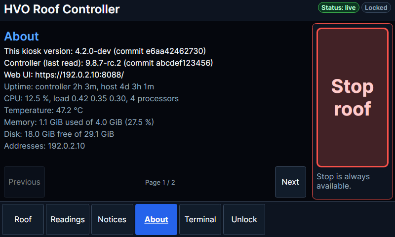

## First-install owner PIN

See [First-install kiosk PIN commissioning](kiosk-commissioning.md) for eligibility, mandatory replacement,
retirement, persistence and rollback. Existing installations receive no temporary access automatically.

## Bounded native redesign

There is no kiosk page scrolling at the supported landscape fixtures: 800×480 at 5.2 pixels/mm, 1280×720 at 8.2,
and provisional 1920×1200 at explicitly configured 8.2 or 9.0. The resolution does not establish a physical size.
`VideoMode` selects the unrotated DRM pixel mode, `Rotation` determines its orientation, and `PixelsPerMillimetre`
independently sets touch/text metrics (DRM scale remains 1). A portrait mode such as 1200×1920 rotated 90° gives a
1920×1200 layout; configure density from the intended panel configuration rather than deriving it from that resolution.

Roof groups position/commanded motion and motion actions into separate panels. Larger layouts also show a compact
readings grid. Readings retains the full status, including input freshness, relay-register evidence and controller name;
the compact input values say **last read** with the successful-read time when reads fail, even while new status
snapshots arrive. Before any successful input read they say **unavailable**, including the drive-running input.
A fresh status timestamp does not establish fresh input values. Recovery restores the current values.
Notices holds recent complete messages. Both use measured Previous/Next pages. Very long tokens, text without spaces
and multiline messages continue across pages without dropping whitespace or splitting a Unicode grapheme; the same
document is available through **Full result** for long Stop answers. PIN loading, failures and empty-user
recovery use the same bounded documents, while Choose/Confirm keeps setup locked until a fresh personal-PIN login.
The first touch/key on a blank screen only wakes it. Stop continues to use the viewer key while locked.

Headless acceptance and capture commands, exact role provenance and remaining platform gates are recorded in
[the native redesign evidence](ui-redesign/native-evidence.md). These are controlled API/fake-plant captures, never a
connection to the observatory controller.

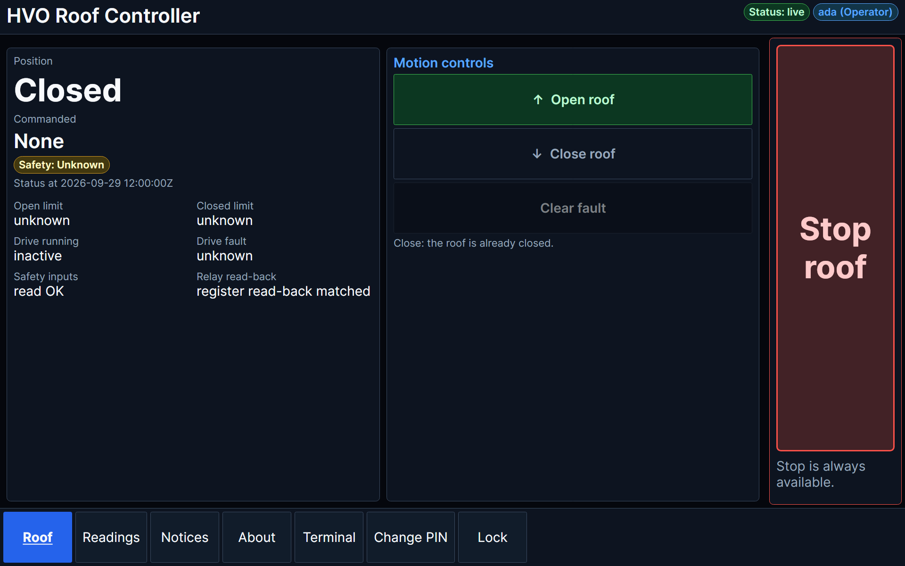

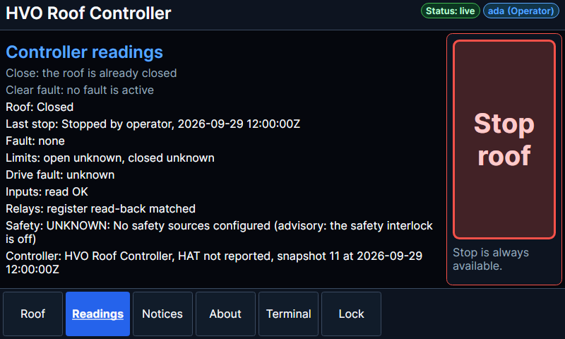

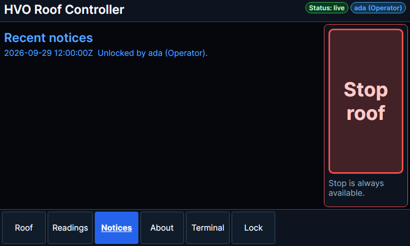

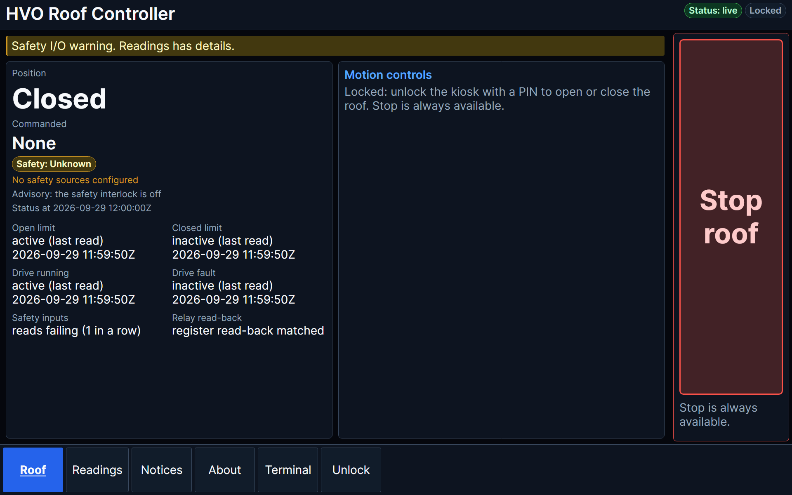

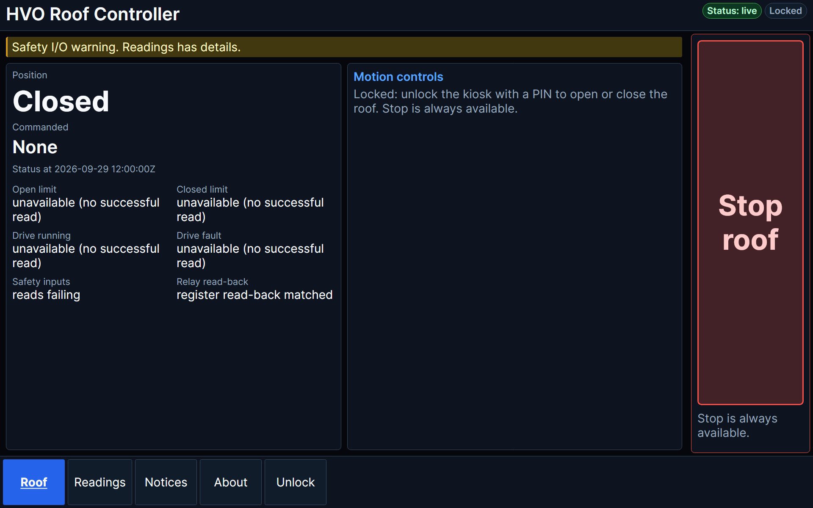

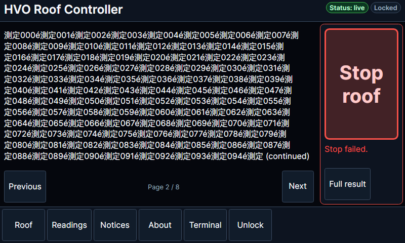
